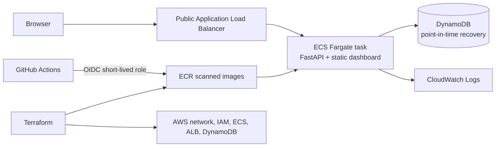

# TaskForge

**A cloud-native task service built to show how software gets shipped and operated.** TaskForge pairs a polished task board with a versioned FastAPI service, DynamoDB persistence, a hardened container, AWS infrastructure as code, and an OIDC-based GitHub Actions release pipeline.

> A portfolio project for a fresher targeting AWS Cloud Engineer, DevOps Engineer, or Platform Engineer roles. The repository explains the design choices and gives you a safe local path to explore the full stack before deploying.

## What it demonstrates

- **AWS:** ECS Fargate, ECR image scanning, Application Load Balancer health checks, DynamoDB point-in-time recovery, CloudWatch logs and Container Insights, VPC routing, and least-privilege task roles.
- **DevOps:** Docker Compose local environment, CI on every pull request, immutable image tags, AWS IAM federation with GitHub Actions OIDC, health-gated rolling deploys, and Terraform-managed infrastructure.
- **Application engineering:** REST API design, Pydantic validation, structured JSON logs, request IDs, liveness/readiness separation, status and priority workflows, and a responsive dashboard.
- **Operational thinking:** documented deployment and teardown, health endpoints, small default task sizing, data protection, and an explicit cost warning.

## Architecture



The application tasks run in public subnets so image pulls and CloudWatch logging work without a NAT gateway. Their security group accepts app traffic only from the load balancer. A DynamoDB gateway endpoint keeps database traffic on the AWS network. GitHub Actions receives short-lived AWS credentials through OIDC; no AWS access key is stored in GitHub.

## Run locally

Requirements: Docker Desktop with Compose enabled.

```bash
git clone https://github.com/<your-name>/taskforge.git
cd taskforge
docker compose up --build
```

Open **http://localhost:8000**. API documentation is at **http://localhost:8000/docs**. The local Compose stack runs DynamoDB Local in memory, so local tasks reset when the stack stops.

Stop the stack with `Ctrl+C`, then run `docker compose down`.

### Run the API without Docker

The API still needs a DynamoDB-compatible endpoint. Start the included DynamoDB Local service with Compose, then install the Python dependencies in another terminal and create the table:

```bash
python -m venv .venv
# Windows: .venv\Scripts\Activate.ps1
# macOS/Linux: source .venv/bin/activate
pip install -r requirements.txt
$env:AWS_ACCESS_KEY_ID="local"; $env:AWS_SECRET_ACCESS_KEY="local"
$env:AWS_REGION="us-east-1"; $env:TASKS_TABLE="taskforge-tasks"
$env:DYNAMODB_ENDPOINT_URL="http://localhost:8001"
aws dynamodb create-table --table-name taskforge-tasks --attribute-definitions AttributeName=task_id,AttributeType=S --key-schema AttributeName=task_id,KeyType=HASH --billing-mode PAY_PER_REQUEST --endpoint-url http://localhost:8001 --region us-east-1
uvicorn app.main:app --reload
```

## API at a glance

| Method | Path | Purpose |
| --- | --- | --- |
| `GET` | `/health/live` | Liveness probe |
| `GET` | `/health/ready` | Checks DynamoDB connectivity |
| `GET` | `/api/v1/metrics` | Uptime and task counts |
| `GET` | `/api/v1/tasks` | List tasks; optional `?status=todo` filter |
| `POST` | `/api/v1/tasks` | Create a task |
| `PATCH` | `/api/v1/tasks/{task_id}` | Update task fields or status |
| `DELETE` | `/api/v1/tasks/{task_id}` | Remove a task |

## Deploy to AWS

**Cost:** The ALB is billed while it exists, even when nobody uses the app. Fargate, public IPv4 addresses, DynamoDB storage/requests, and CloudWatch also incur usage charges. Review current prices for your region before applying. Run `terraform destroy` when you finish your demo. Do not deploy to an account without a budget alert.

1. Install Terraform 1.6+ and configure AWS credentials locally. Choose the region you want to use; the default is `ap-south-1`.
2. From `terraform/`, initialize and review the plan:

   ```bash
   terraform init
   terraform plan -var="aws_region=ap-south-1" -var="github_repository=YOUR_GITHUB_NAME/taskforge"
   ```

3. Apply after reviewing the resources and estimated costs:

   ```bash
   terraform apply -var="aws_region=ap-south-1" -var="github_repository=YOUR_GITHUB_NAME/taskforge"
   ```

   Terraform creates the service with zero running tasks so it can succeed before an image has been pushed. Build and push the first image from the repository root using the ECR URL printed by Terraform:

   ```bash
   aws ecr get-login-password --region ap-south-1 | docker login --username AWS --password-stdin YOUR_ACCOUNT.dkr.ecr.ap-south-1.amazonaws.com
   docker build -t taskforge:initial .
   docker tag taskforge:initial YOUR_ECR_URL:initial
   docker push YOUR_ECR_URL:initial
   ```

   Start the service after the first image is available:

   ```bash
   terraform apply -var="aws_region=ap-south-1" -var="github_repository=YOUR_GITHUB_NAME/taskforge" -var="desired_count=1"
   ```

4. Read `github_deploy_role_arn` from Terraform output. Add it to GitHub repository **Settings → Secrets and variables → Actions** as `AWS_DEPLOY_ROLE_ARN`.
5. Push to `main`. CI validates the code and builds the image; the deploy workflow publishes a commit-SHA-tagged image and waits for ECS to become stable. Keep `desired_count=1` in Terraform after the first deploy so later infrastructure changes preserve the running service.
6. Open `application_url` from Terraform output. Check CloudWatch logs in `/ecs/taskforge` and test `/health/ready`.
7. Remove the billable demo resources when you are done:

   ```bash
   terraform destroy -var="aws_region=ap-south-1" -var="github_repository=YOUR_GITHUB_NAME/taskforge"
   ```

Terraform state contains infrastructure metadata. Keep it local or use a private, encrypted remote state backend for a team project; do not commit state files.

### AWS GitHub OIDC setup

The AWS account must have the GitHub Actions OIDC provider (`https://token.actions.githubusercontent.com`). The role trust is restricted to this repository's `main` branch. Terraform only creates the scoped deploy role when `github_repository` is set. The CI workflow needs no AWS credentials; the deploy workflow uses `id-token: write` and the role ARN secret.

## Checks

```bash
pip install -r requirements-dev.txt
ruff check app tests
pytest -q
docker build -t taskforge:local .
```

The tests use Moto's in-memory DynamoDB and do not need AWS credentials. The pull request workflow runs linting, tests, and a container build.

## Design notes and next steps

- The demo uses DynamoDB `Scan` for the small task board and metrics summary. For a larger workload, add an access-pattern-driven index and cursor pagination instead of scanning the table.
- The public endpoint is HTTP to keep the demo easy to deploy. Add ACM, HTTPS listener, and a domain before exposing real user data.
- Authentication and per-user authorization are intentionally left as a documented production extension; this demo should not hold sensitive or personal data.
- Useful interview extensions: autoscaling, blue/green releases, alarms and dashboards, WAF, secrets rotation, multi-environment state, and a cost estimate.

## Repository map

```text
app/                   FastAPI service and dashboard
tests/                 API lifecycle tests with in-memory DynamoDB
terraform/             AWS network, IAM, ECR, ECS, ALB and DynamoDB
.github/workflows/     Pull request CI and OIDC-based deployment
Dockerfile             Non-root, health-checked application image
docker-compose.yml     Local API and DynamoDB Local
```

## License

MIT. See [LICENSE](LICENSE).

